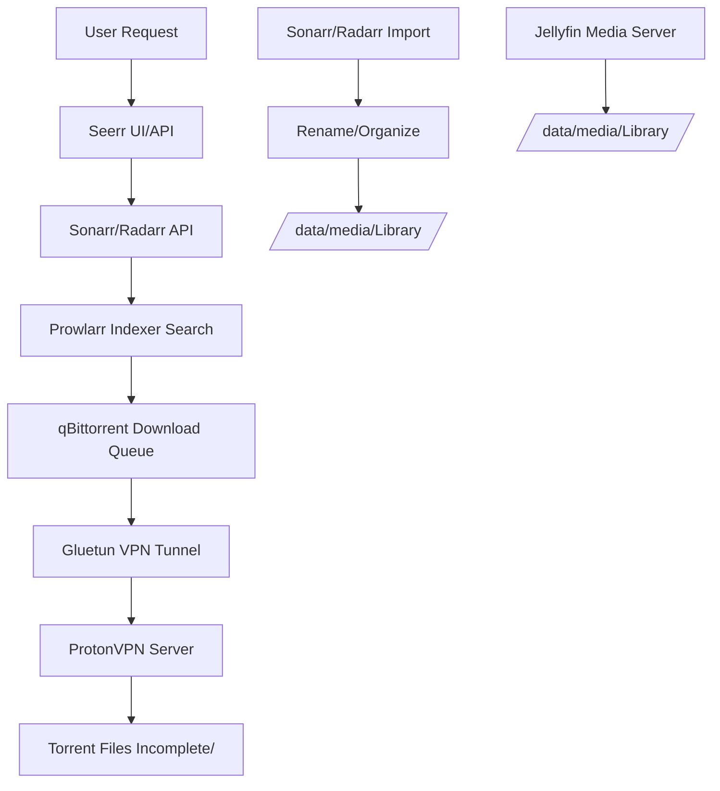

# Architecture Overview

This document describes the high-level architecture of the ARR Media Stack.

## System Components

### Core Services

1. **Gluetun** - WireGuard VPN gateway for ProtonVPN
2. **qBittorrent** - BitTorrent client (network-isolated via Gluetun)
3. **Sonarr** - TV series management
4. **Radarr** - Movie management  
5. **Lidarr** - Music management
6. **Prowlarr** - Centralized indexer management
7. **Bazarr** - Subtitle management for Sonarr/Radarr
8. **Seerr** - User request interface
9. **Jellyfin** - Media server
10. **Recyclarr** - Declarative quality profile configuration

### Network Segmentation

The stack uses three isolated Docker networks:

- `download_net` (internal): Gluetun + qBittorrent only for VPN traffic
- `app_net`: ARR services communication layer  
- `media_net` (internal): Jellyfin media server isolation

## Data Flow



## Security Boundaries

1. **Network Isolation**: qBittorrent cannot bypass VPN via `network_mode: service:gluetun`
2. **Privilege Reduction**: All containers run with `--cap-drop=ALL` and user namespaces
3. **Secrets Management**: Runtime injection only, never committed to Git
4. **Least Privilege Access**: Containers access only explicitly mounted volumes

## Storage Layout

```text
/data/
├── torrents/          # Download queue (incomplete files)
│   ├── incomplete/    # Active downloads
│   ├── movies/        # Movie torrent storage
│   ├── tv/            # TV torrent storage  
│   └── music/         # Music torrent storage
└── media/             # Final library for Jellyfin
    ├── movies/        # Imported movies
    ├── tv/            # Imported TV series
    └── music/         # Imported music albums
```

## Deployment Model

The stack is deployed via Docker Compose with:
- Declarative configuration in `config/*.yaml` files
- Environment variables from `.env.example` template  
- Secrets injected at runtime (never stored in repo)
- Idempotent deployment scripts for upgrades and maintenance
