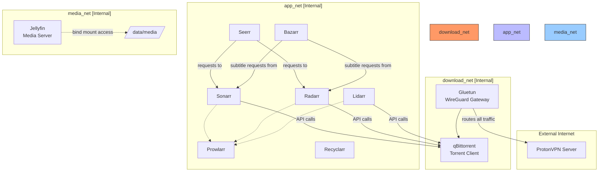

# Network Architecture

This document describes the network segmentation strategy for the ARR Media Stack.

## Docker Networks Overview

The stack uses three isolated bridge networks to enforce security boundaries:

### 1. download_net (`arr-stack-download-net`)

**Purpose**: VPN traffic isolation  
**Services**: Gluetun, qBittorrent only  
**Characteristics**:
- Internal network (not exposed publicly)
- All DNS queries routed through Gluetun's WireGuard tunnel
- Prevents DNS leaks and IP exposure when VPN is active
- Enforces kill-switch behavior via `BLOCK_OUTSIDE_VPN_NETWORKS=true`

### 2. app_net (`arr-stack-app-net`)

**Purpose**: ARR services communication layer  
**Services**: Sonarr, Radarr, Lidarr, Prowlarr, Bazarr, Seerr, Recyclarr  
**Characteristics**:
- Internal network for service-to-service API calls
- Not exposed to public internet by default
- Enables secure internal communication between management and download services

### 3. media_net (`arr-stack-media-net`)

**Purpose**: Media server isolation  
**Services**: Jellyfin only  
**Characteristics**:
- Isolated from other networks for security
- Accesses media files via bind mounts (not network shares)
- Can be exposed locally if needed, but not by default

## Network Diagram



## Security Implications

### Network Isolation Benefits

1. **qBittorrent cannot bypass VPN**: By using `network_mode: service:gluetun`, qBittorrent shares Gluetun's network namespace and cannot resolve public IPs directly or leak traffic via DNS.

2. **Service isolation prevents lateral movement**: If one ARR service is compromised, it cannot reach Jellyfin (media_net) or the internet without going through proper channels.

3. **DNS leak prevention**: All containers on download_net route DNS queries through Gluetun's WireGuard tunnel to ProtonVPN servers only.

### Port Exposure Strategy

- No services are exposed publicly by default
- Only local/LAN ports are available:
  - Jellyfin UI (optional, configurable)
  - Seerr UI (configurable for user access)
  - qBittorrent WebUI (internal port 8091 only)
  
## Network Configuration

```yaml
networks:
  download_net:
    name: arr-stack-download-net
    driver: bridge
  
  app_net:
    name: arr-stack-app-net
    driver: bridge
    internal: false
    
  media_net:
    name: arr-stack-media-net
    driver: bridge
    internal: true
```

## Best Practices

1. Never expose qBittorrent ports publicly - use reverse proxy if external access needed
2. Keep app_net services on the same network for efficient API communication  
3. Use media_net isolation to protect Jellyfin from direct internet exposure
4. Monitor container logs for unusual cross-network traffic patterns
5. Regularly review Docker Compose configuration for unintended network connections
